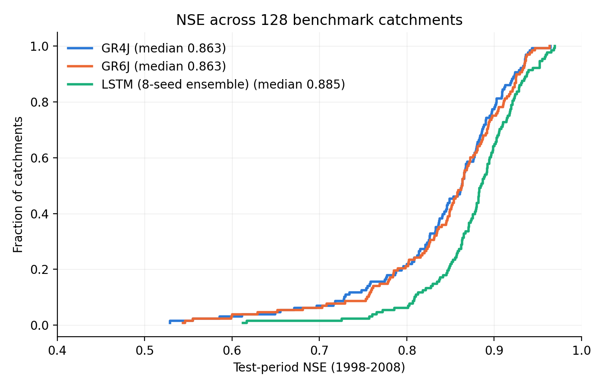
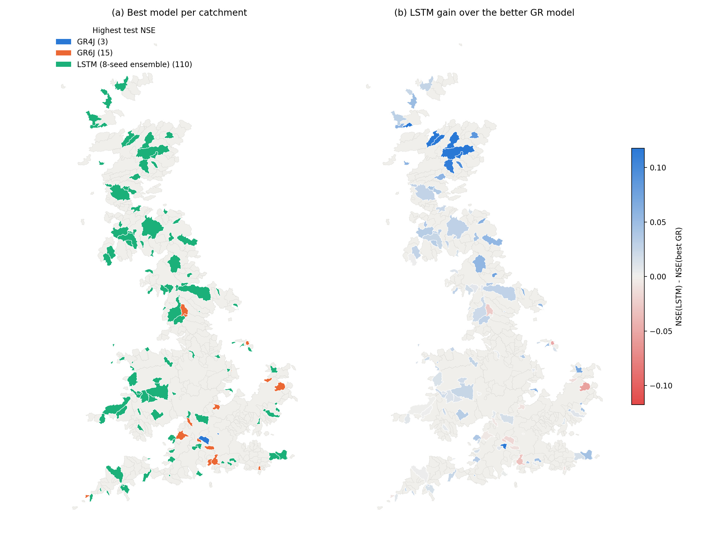
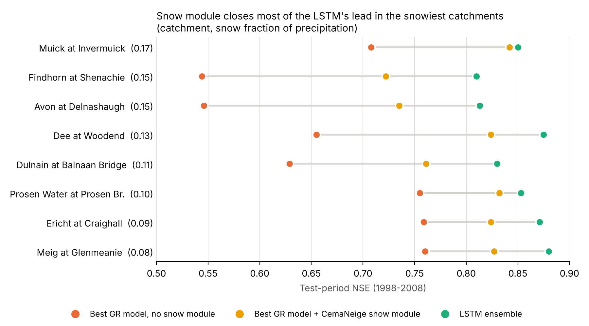
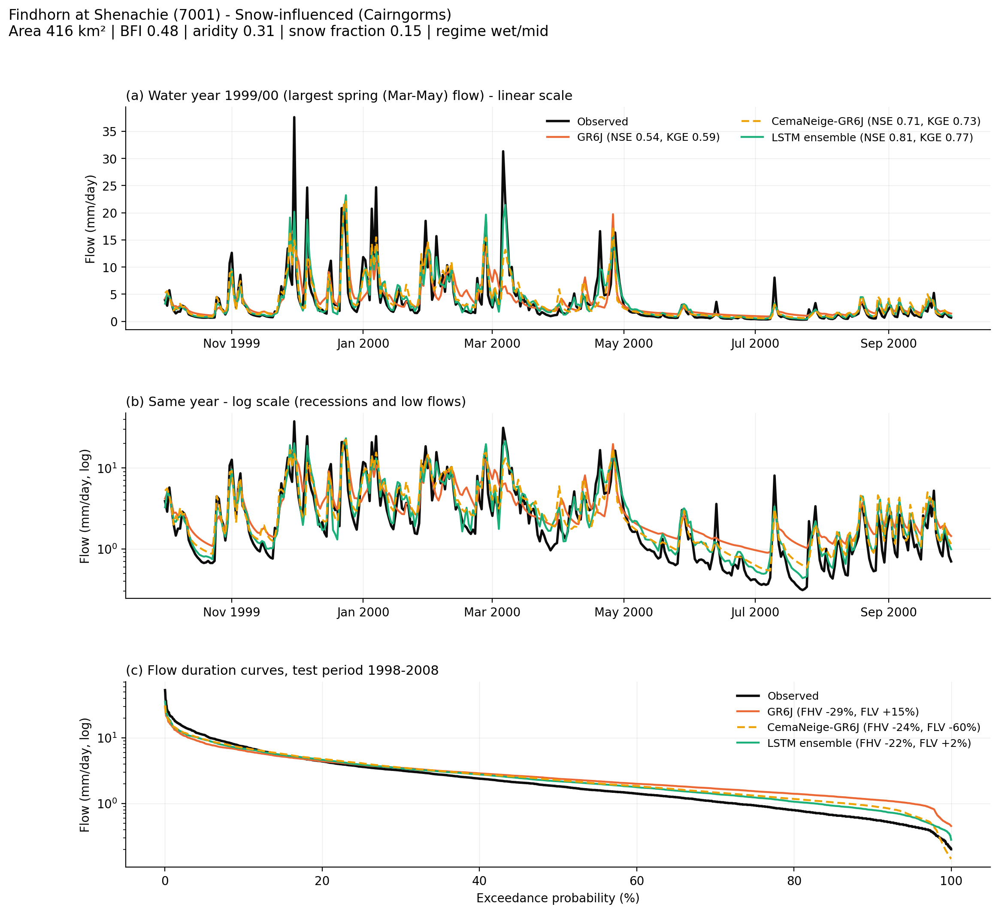
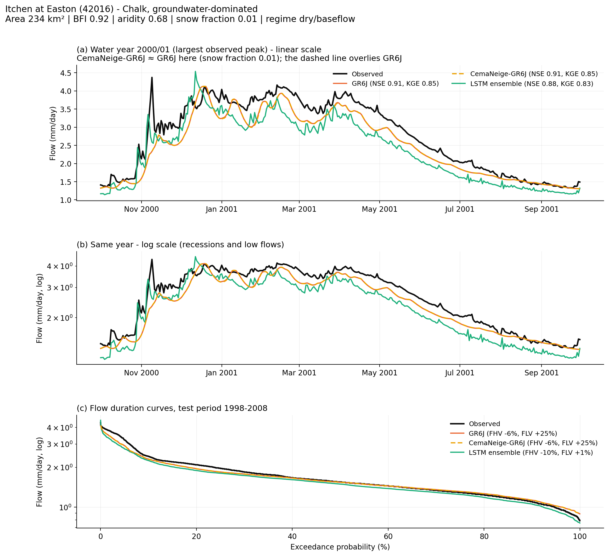
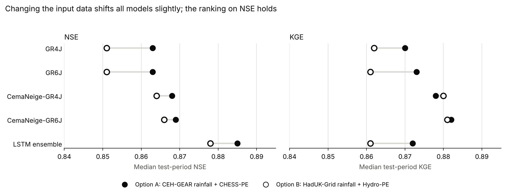
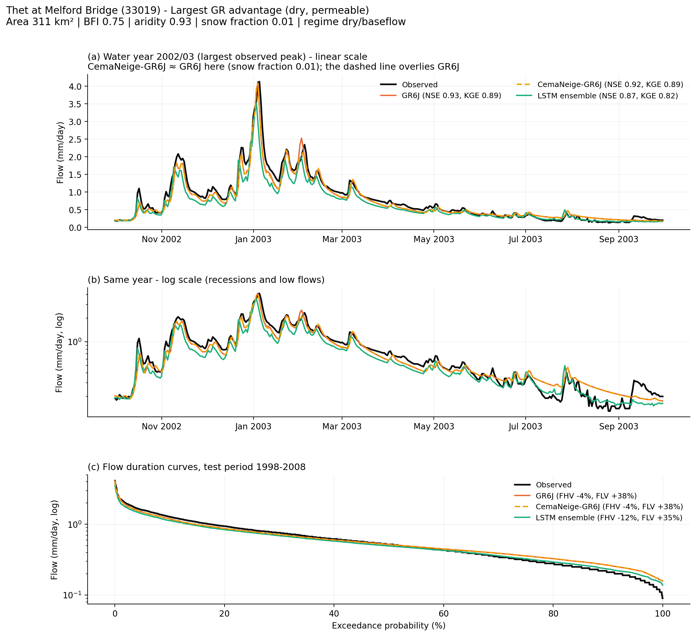
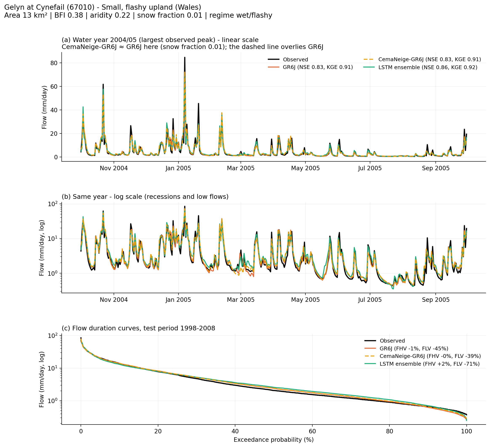

# Rainfall–runoff model benchmark: conceptual models vs deep learning on 128 UK catchments

**Technical report** · Author: Raphel Etoyiva Abine (Doctoral Researcher, Brunel University London)· November 2026

This project compares how well four conceptual rainfall–runoff models (GR4J, GR6J, and both with a snow module) and a deep-learning model (LSTM) simulate daily river flow across 128 near-natural catchments in Great Britain. It follows a published benchmarking protocol, tests every model on the same unseen decade, and checks whether the conclusions still hold when the input rainfall and evaporation data are changed.

---

## 1. Summary

| | |
|---|---|
| **Question** | Does a deep-learning model (LSTM) simulate UK river flows better than established conceptual models, and where? |
| **Answer** | Yes, on most measures and in most places, but the margin is small (median NSE +0.02), and much of the advantage in snowy catchments disappears when the conceptual model is given a snow module. |
| **Confidence** | High. The ranking is statistically significant and unchanged when the input data are swapped (93% of catchments have the same best model under both input sets). |

**Key findings**

1. **The LSTM is the most accurate model overall.** Median test NSE was **0.885**, against 0.863 for GR4J and GR6J. It scored higher than both GR models in **110 of 128 catchments**.
2. **Most of its biggest gains come from snow.** In the Cairngorms the LSTM beat the GR models by up to 0.27 NSE. Adding the CemaNeige snow module to the GR models closed **66–94%** of that gap.
3. **Conceptual models still win in chalk catchments.** In groundwater-dominated catchments in southern and eastern England (Itchen, Thet, Lambourn), GR6J beat the LSTM, though by small margins (≤0.055 NSE).
4. **No model handles low flows or floods well.** All models underestimate the highest 2% of flows by about 10%. Low-flow errors are large and go in different directions for different models.
5. **The results are robust to the input data.** Switching from CEH-GEAR/CHESS-PE to HadUK-Grid/Hydro-PE inputs lowered all scores slightly (−0.003 to −0.010 NSE) but did not change the ranking.

**What this means in practice:** for daily flow simulation across many UK catchments, an LSTM trained on a large catchment sample is a strong default. A well-configured conceptual model (GR6J with a snow module) comes within about 0.01–0.02 NSE, scores as well or better on KGE, remains easier to explain, and is the safer choice in chalk catchments and for low-flow work.

---

## 2. Scope and approach

### 2.1 Data

All data come from **CAMELS-GB v2** (UK Centre for Ecology & Hydrology), which provides daily river flow, catchment-average weather and catchment descriptors for 671 gauged catchments in Great Britain.

### 2.2 Catchment selection

| Step | Rule | Catchments |
|---|---|---|
| Start | All CAMELS-GB v2 catchments | 671 |
| Near-natural only | UK Benchmark Network catchments (`benchmark_catch = Y`) | 137 |
| Plausible water balance | Runoff ratio ≤ 1 (removed 27073, 44009) | 135 |
| Enough flow data | ≥ 90% of days with flow in both the training and test periods | **128** |

The benchmark catchments cover a wide range of UK conditions: aridity from 0.12 to 1.06, baseflow index from 0.23 to 0.92, and areas from 4 to 1,506 km². For the analysis they were grouped into nine **regimes** (three aridity classes × three baseflow-index classes).

### 2.3 Protocol

Periods and LSTM settings follow the published GB benchmark by Lees et al. (2021), so the results can be compared with theirs.

| Item | Setting |
|---|---|
| Warm-up | 1985–1987 (GR models) |
| Training / calibration | 1 Jan 1988 – 31 Dec 1997 |
| Test (unseen) | 1 Jan 1998 – 31 Dec 2008 |
| Main inputs (Option A) | CEH-GEAR rainfall, CHESS-PE potential evaporation, CHESS-met temperature |
| Sensitivity inputs (Option B) | HadUK-Grid rainfall and temperature, Hydro-PE potential evaporation |
| Calibration / training target | NSE (same objective for all models) |

One deliberate difference from Lees et al.: their conceptual benchmarks were partly calibrated on the evaluation period. Here, **every model is calibrated or trained on 1988–1997 only and tested on 1998–2008**, so the comparison is fair.

### 2.4 Models

| Model | Type | Parameters | How it was set up |
|---|---|---|---|
| **GR4J** | Conceptual, lumped, daily | 4 per catchment | airGR (INRAE), `Calibration_Michel`, calibrated separately for each catchment |
| **GR6J** | As GR4J plus a slow groundwater store and improved groundwater exchange | 6 per catchment | As above |
| **CemaNeige-GR4J / -GR6J** | As above plus a degree-day snow module with 5 elevation bands | 6 / 8 per catchment | As above |
| **LSTM** | Deep learning (long short-term memory network) | ~23,000, shared across catchments | neuralhydrology. One model trained on 663 catchments with 22 catchment descriptors. 8 runs with different random seeds, averaged into an ensemble |

### 2.5 How performance was measured

All models were scored with the same code (neuralhydrology's metric functions) on the 1998–2008 test period.

| Metric | What it tells you | Perfect value |
|---|---|---|
| **NSE** | Overall fit, dominated by high flows | 1 |
| **KGE** | Overall fit, split into timing, variability and volume | 1 |
| **FHV** | Bias in the highest 2% of flows (floods) | 0% |
| **FLV** | Bias in the lowest 30% of flows (low flows) | 0% |
| **FMS** | Bias in the mid-range of the flow duration curve | 0% |
| **Peak timing** | Average error in the timing of flow peaks | 0 days |

Model pairs were compared catchment by catchment using the Wilcoxon signed-rank test, with a Holm correction for running many tests.

---

## 3. Results

### 3.1 Overall performance

**Table 1. Median test-period scores across 128 catchments (Option A inputs).** Best value in each row in bold.

| Metric | GR4J | GR6J | CemaNeige-GR4J | CemaNeige-GR6J | LSTM ensemble |
|---|---|---|---|---|---|
| NSE | 0.863 | 0.863 | 0.868 | 0.869 | **0.885** |
| KGE | 0.870 | 0.873 | 0.878 | **0.882** | 0.872 |
| Correlation (r) | 0.932 | 0.931 | 0.936 | 0.935 | **0.946** |
| FHV (floods, %) | −11.6 | −10.8 | **−9.8** | −10.1 | −11.0 |
| FLV (low flows, %) | −35.5 | −8.8 | −40.8 | **+1.0** | +25.1 |
| Peak timing (days) | 0.31 | 0.32 | 0.30 | 0.28 | **0.26** |



*Figure 1. Test-period NSE across all 128 catchments. The LSTM curve sits to the right of the GR curves, which means higher NSE across almost the whole range, including the weakest catchments.*

**Main points**

- **The LSTM has a significantly higher NSE than both GR models.** It is better than GR4J in 113 catchments and GR6J in 111 (both p < 0.001). Its timing is also significantly better.
- **There is no significant difference in KGE.** The LSTM tracks the shape of the hydrograph better (higher correlation), but it underestimates total flow volume by about 3%, which cancels out the gain.
- **The ensemble matters.** Single LSTM runs scored 0.875–0.880. Averaging 8 runs raised this to 0.885.
- **GR6J beats GR4J in 94 of 128 catchments** (significant), but the gain is tiny (median +0.002 NSE).

### 3.2 Where each model wins



*Figure 2. (a) Model with the highest test NSE in each catchment. (b) LSTM NSE minus the better GR model (blue = LSTM better, red = GR better).*

**Table 2. Median test NSE by catchment regime, and number of catchments where each model was best.**

| Regime (aridity / baseflow) | GR4J | GR6J | LSTM | Best model: GR4J / GR6J / LSTM |
|---|---|---|---|---|
| dry / baseflow (e.g. chalk) | 0.861 | 0.863 | 0.871 | 2 / 7 / 11 |
| dry / flashy | 0.800 | 0.793 | 0.811 | 0 / 1 / 9 |
| dry / mid | 0.856 | 0.852 | 0.876 | 0 / 3 / 9 |
| mid / baseflow | 0.893 | 0.887 | 0.908 | 1 / 1 / 16 |
| mid / flashy | 0.867 | 0.866 | 0.883 | 0 / 3 / 9 |
| mid / mid | 0.847 | 0.854 | 0.889 | 0 / 0 / 13 |
| wet / baseflow | 0.798 | 0.806 | 0.880 | 0 / 0 / 4 |
| wet / flashy | 0.862 | 0.864 | 0.889 | 0 / 0 / 21 |
| wet / mid | 0.880 | 0.886 | 0.911 | 0 / 0 / 18 |
| **All** | | | | **3 / 15 / 110** |

- **The LSTM wins almost everywhere in the wet north and west.** It took all 43 wet catchments.
- **GR6J's wins cluster in the dry, permeable south and east.** Of the eight catchments where GR beats the LSTM most, seven are chalk or other permeable lowland catchments: Thet (−0.055), Lud (−0.051), Cheriton Stream (−0.043), Itchen (−0.033), Aldbourne (−0.021), West Glen (−0.019) and Lambourn (−0.017). The exception is the Aire in the Pennines (−0.025).

### 3.3 Why the LSTM wins in Scotland: snow

Five of the ten weakest GR4J catchments were in the Cairngorms and north-east Scotland, the UK's snowiest area, and the original GR runs had no snow module. Without one, snowfall is treated as rain and runs off straight away, rather than being stored and released as meltwater in spring. To test whether this explains the LSTM's advantage, both GR models were rerun with the **CemaNeige** snow module. Nothing else changed.



*Figure 3. Test NSE in the eight snowiest catchments: best GR model without snow (orange), with the CemaNeige snow module (yellow), and the LSTM (green).*

| Result | Value |
|---|---|
| NSE gain from adding snow, linked to snow fraction | Spearman ρ = **+0.69** (p < 10⁻¹⁹) |
| Share of the LSTM's lead closed in the five snowiest catchments | **66–94%** |
| Link between the LSTM's advantage and snow fraction, before → after adding snow | ρ = 0.52 → 0.23 (Option A); 0.55 → **0.07, not significant** (Option B) |

**Conclusion:** most of the LSTM's advantage in snowy catchments comes from **representing snow**, which it learns from the temperature input, rather than from the network itself. A conceptual model given the missing process recovers most of the gap. Across all 128 catchments, the LSTM still keeps a smaller lead over the snow-module GR models (median +0.017–0.022 NSE), so its advantage is not only about snow.



*Figure 4. Findhorn at Shenachie, the year with the largest spring flow. Without snow, GR6J (orange) produces false winter peaks and runs far too high all summer (panel b). The snow-module version (dashed) and the LSTM follow the observed seasonal pattern much more closely.*

### 3.4 Why GR wins in chalk: groundwater



*Figure 5. Itchen at Easton during the very wet winter of 2000/01, when chalk catchments in southern England saw widespread groundwater flooding. The observed flow (black) is a smooth groundwater-fed curve. GR6J follows it more closely. The LSTM is consistently too low and adds short spikes that the river does not show.*

In groundwater-dominated catchments the LSTM appears to apply the quick rainfall response it learned from the many flashier catchments it was trained on. One likely reason is that **the LSTM was not given any hydrogeology information** (for example, the percentage of the catchment on chalk aquifer), even though CAMELS-GB v2 provides it. Testing this is the main recommended next step (Section 6).

### 3.5 Floods and low flows

- **Floods:** every model underestimates the highest 2% of flows by about **10–12%** (FHV), and simulated flow variability is about 10% too low. This is a known side effect of training all models on NSE (Gupta et al., 2009), and it matters if these models are used for flood estimation.
- **Low flows:**
  - GR4J underestimates low flows (median FLV −35%).
  - The LSTM overestimates them consistently (+25%).
  - GR6J's median is close to zero, but only because large errors in opposite directions cancel out.
  - In practice, **none of the models is reliable for low-flow applications without further work.**
- **A caution on FLV:** FLV is calculated on log-transformed flows, so it exaggerates tiny differences at the very lowest flows. In the Gelyn catchment the LSTM's flow duration curve is visually almost identical to the observed one, yet its FLV is −71% (see appendix).

### 3.6 Sensitivity to input data

All models were recalibrated and retrained with a second, independent set of input data (Option B), and the evaluation was repeated.



*Figure 6. Median test NSE and KGE under the two input sets.*

**Table 3. Effect of switching from Option A to Option B inputs.**

| Model | Median NSE (A → B) | Catchments improved | Agreement between A and B across catchments (Spearman ρ) |
|---|---|---|---|
| GR4J | 0.863 → 0.851 | 20 / 128 | 0.98 |
| GR6J | 0.863 → 0.851 | 20 / 128 | 0.95 |
| CemaNeige-GR4J | 0.868 → 0.864 | 50 / 128 | 0.96 |
| CemaNeige-GR6J | 0.869 → 0.866 | 47 / 128 | 0.93 |
| LSTM ensemble | 0.885 → 0.878 | 25 / 128 | 0.95 |

- **The ranking is unchanged:** LSTM > CemaNeige-GR6J > GR6J > GR4J, and every step is significant under Option B. The same model is best in **93%** of catchments under both input sets.
- **The models with a snow module are the least sensitive** to the choice of input data.
- **One result depends on the inputs.** The LSTM's peak-timing advantage (0.26 vs 0.31 days under Option A) almost disappears under Option B (0.30 days). This needs further checking (Section 6) before it is relied on.

---

## 4. Implications for practice

| Use case | Recommendation from this study |
|---|---|
| Daily flow simulation across many catchments (e.g. national screening, water resources) | An LSTM trained on many catchments gives the best overall accuracy. Use an ensemble of runs, not a single run |
| Explainable modelling for a single catchment (e.g. a scheme appraisal) | GR6J with a snow module is within ~0.01–0.02 NSE of the LSTM, scores as well or better on KGE, and each parameter has a clear conceptual meaning |
| Chalk / groundwater-dominated catchments | Prefer GR6J, or add hydrogeology information to the LSTM before relying on it |
| Upland Scotland and other snow-affected catchments | Always include a snow process. Without one, conceptual models perform poorly (NSE ~0.55 in the worst cases) |
| Flood peaks and low flows | Do not rely on NSE-trained models alone. Calibrate or train with flood- or low-flow-focused objectives, and check flow duration curves |
| Model runtime | GR models: seconds per catchment (GR4J for all 128 catchments in ~2 minutes). LSTM: ~65–70 minutes per training run on one GPU, ~9 GPU-hours for an 8-run ensemble |

---

## 5. Limitations

- **One test decade (1998–2008).** Performance in more recent extremes (e.g. the 2018 and 2022 droughts) was not tested. The main input data end in 2019, but the Option B inputs run to 2022 and would allow this.
- **Near-natural catchments only.** Results may not carry over to catchments with heavy abstraction, reservoirs or urban drainage.
- **The comparison is between two kinds of model, by design.** The LSTM learns from 663 catchments, while each GR model is calibrated on one. This follows standard published practice, but part of the LSTM's advantage comes from that extra information.
- **One training objective (NSE).** Training on KGE or a flood-focused objective could change the results for floods and variability.
- **Approximate elevation bands for CemaNeige.** The elevation distribution was interpolated from five values per catchment, which may slightly understate the snow module's benefit.

---

## 6. Recommended next steps

| # | Work | Why | Effort |
|---|---|---|---|
| 1 | Retrain the LSTM with hydrogeology descriptors (aquifer type and productivity) | Tests whether missing groundwater information explains the LSTM's weakness in chalk | ~9 GPU-hours |
| 2 | Run with CEH-GEAR rainfall plus Hydro-PE evaporation | Separates the effect of the rainfall product from the evaporation product on peak timing | ~10 GPU-hours |
| 3 | Hourly flood forecasting with PDM (the rainfall-runoff model used in UK flood forecasting) at several lead times | Moves from daily simulation to operational forecasting | Separate project |
| 4 | Calibrate and train with a flood-focused or low-flow-focused objective | Addresses the shared ~10% flood underestimation | ~1 day plus GPU time |

---

## 7. Reproducing this work

**Software:** Python 3.11, PyTorch, neuralhydrology, pandas, geopandas, statsmodels; R with airGR.

**Repository layout**

```
├── README.md                  <- this report
├── figures/                   <- all figures used above
├── notebooks/Code.ipynb       <- the original Colab notebook
├── scripts/                   <- the same workflow as numbered, runnable scripts
│   ├── README.md              <- run order, timings and setup
│   ├── config.py              <- project paths and shared helpers
│   ├── 01_ ... 15_*.py        <- download → exploration → selection → models → evaluation
│   ├── gr_run.R               <- GR4J / GR6J / CemaNeige calibration (input option A or B)
│   ├── train_lstm.py          <- LSTM ensemble training (neuralhydrology)
│   └── make_summary_figures.py
└── results/                   <- metric and parameter tables for every model and catchment
                                  (see results/README.md for what each file contains)
```

**Run order:** download CAMELS-GB v2 → select catchments → calibrate the GR models → convert data for neuralhydrology → train 8 LSTM runs per input option → evaluate all models with the same metric code → compare. The full sequence, with timings, is in [`scripts/README.md`](scripts/README.md).

---

## Data licence and attribution

CAMELS-GB v2: Coxon, G. et al. (2025). *Catchment boundaries, daily and sub-daily hydrometeorological time series, groundwater level time series and attributes for 671 catchments in Great Britain (CAMELS-GB v2).* NERC EDS Environmental Information Data Centre. https://doi.org/10.5285/9a46d428-958f-4ac1-86eb-94eee70c0955

> Contains data supplied by UK Centre for Ecology & Hydrology, British Geological Survey, Environment Agency, Natural Resources Wales and Scottish Environmental Protection Agency.

## References

- Coxon, G. et al. (2026). CAMELS-GB v2: hydrometeorological time series and landscape attributes for 671 catchments in Great Britain. *Earth System Science Data*, 18, 4345–4371.
- Kratzert, F. et al. (2022). NeuralHydrology — A Python library for deep learning research in hydrology. *Journal of Open Source Software*, 7(71), 4050.
- Lees, T. et al. (2021). Benchmarking data-driven rainfall–runoff models in Great Britain: a comparison of long short-term memory (LSTM)-based models with four lumped conceptual models. *Hydrology and Earth System Sciences*, 25, 5517–5534.
- Kratzert, F. et al. (2019). Towards learning universal, regional, and local hydrological behaviors via machine learning applied to large-sample datasets. *Hydrology and Earth System Sciences*, 23, 5089–5110.
- Coron, L. et al. (2017). The suite of lumped GR hydrological models in an R package. *Environmental Modelling & Software*, 94, 166–171.
- Valéry, A., Andréassian, V. and Perrin, C. (2014). 'As simple as possible but not simpler': What is useful in a temperature-based snow-accounting routine? Part 2 – Sensitivity analysis of the Cemaneige snow accounting routine on 380 catchments. *Journal of Hydrology*, 517, 1176–1187.
- Pushpalatha, R. et al. (2011). A downward structural sensitivity analysis of hydrological models to improve low-flow simulation. *Journal of Hydrology*, 411, 66–76.
- Gupta, H. V. et al. (2009). Decomposition of the mean squared error and NSE performance criteria. *Journal of Hydrology*, 377, 80–91.
- Yilmaz, K. K., Gupta, H. V. and Wagener, T. (2008). A process-based diagnostic approach to model evaluation. *Water Resources Research*, 44, W09417.
- Perrin, C., Michel, C. and Andréassian, V. (2003). Improvement of a parsimonious model for streamflow simulation. *Journal of Hydrology*, 279, 275–289.

---

## Appendix: further case studies



*Figure A1. Thet at Melford Bridge, the catchment where GR has its largest advantage. The LSTM is too low through the whole winter recession. All models overestimate the lowest flows (FLV +35–38%).*



*Figure A2. Gelyn at Cynefail, a small, flashy upland catchment in Wales. All models perform well (NSE 0.83–0.86). The flow duration curves almost overlap, yet the LSTM's FLV is −71%, which shows how sensitive FLV is at very low flows.*
